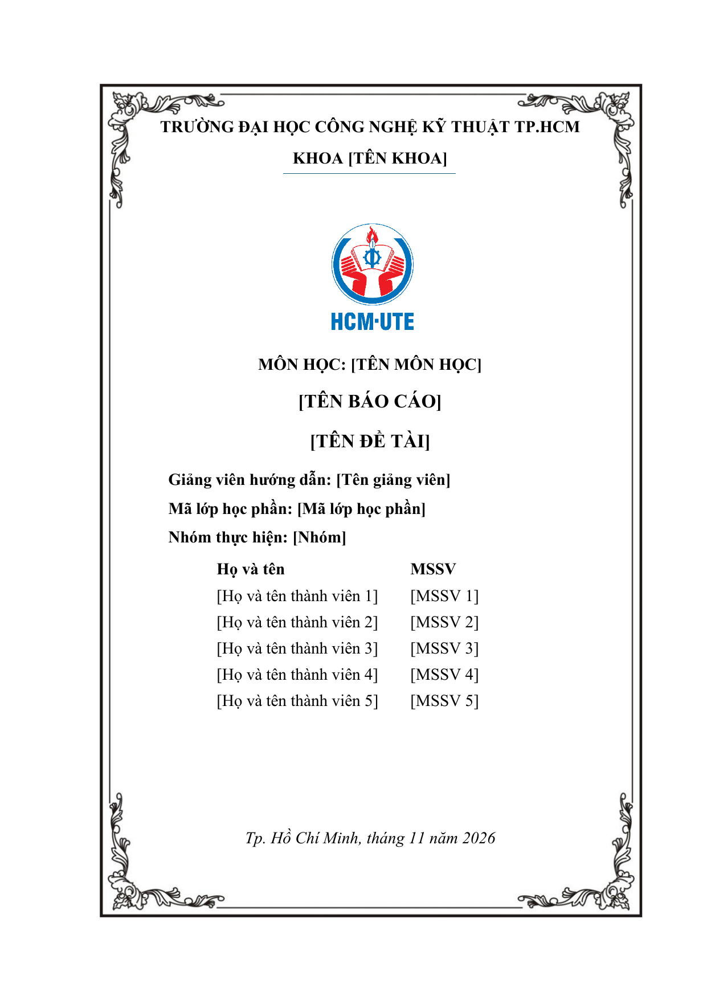

# Mẫu báo cáo Word

Mẫu báo cáo `.docx` này được mình tinh chỉnh và hoàn thiện trong suốt quá trình học tập tại Trường Đại học Công nghệ Kỹ thuật TP.HCM (HCMUTE), áp dụng linh hoạt cho các bài tập lớn, tiểu luận và đồ án môn học. Mình chia sẻ lại để các bạn có thể tham khảo và phần nào đó giúp các bạn tiết kiệm thời gian căn chỉnh.

> **Lưu ý:** Đây **không phải tài liệu chính thức** của Trường hay của Khoa. Mẫu chỉ là sản phẩm cá nhân, được đúc kết từ kinh nghiệm học tập của tác giả và chia sẻ với mục đích tham khảo. Mỗi môn học, giảng viên hoặc khoa có thể có quy định trình bày riêng. Vui lòng đối chiếu với yêu cầu của giảng viên trước khi sử dụng và chỉnh lại mẫu nếu cần.

Mẫu có sẵn hệ thống style, đánh số tự động cho Chương, Mục, Hình, Bảng, Phụ lục và Mục lục tự cập nhật. Bạn chỉ cần điền nội dung, không phải định dạng lại từ đầu cho mỗi môn.

## Ảnh minh họa

Trang bìa của mẫu:

  

## Giới thiệu nhanh

- Mẫu sử dụng khổ A4, Font Times New Roman 14pt, theo quy cách thường gặp ở các báo cáo môn học
- Tự đánh số `CHƯƠNG X:`, `1.1.`, `1.1.1.`, `Hình X.Y:`, `Bảng X.Y:`, `PHỤ LỤC A.`
- Số Hình và Bảng tự reset khi sang Chương mới (Hình 2.1, Bảng 2.1...)
- Mục lục, Danh mục hình ảnh, Danh mục bảng biểu cập nhật chỉ với một thao tác
- Có sẵn ví dụ minh họa cho từng loại style: danh sách, bảng, hình, code block, phụ lục

## Nội dung repo

| File | Mô tả |
|------|-------|
| `mau-bao-cao.docx` | File mẫu báo cáo |
| `huong-dan-su-dung.docx` | Hướng dẫn áp dụng bộ style, cập nhật mục lục... |
| `images/bia.png` | Ảnh minh họa trang bìa |

## Bắt đầu nhanh

1. Tải `mau-bao-cao.docx`, dùng **Save As** để lưu thành tên báo cáo của bạn.
2. Khi mở file, nếu Word hỏi *"có cập nhật các trường trong tài liệu không"* thì chọn **Có**.
3. Điền các chỗ trong ngoặc vuông ở bìa: `[TÊN KHOA]`, `[TÊN MÔN HỌC]`, `[TÊN BÁO CÁO]`, `[TÊN ĐỀ TÀI]`...., cùng thông tin giảng viên, mã lớp và danh sách thành viên.
4. Xóa các phần ghi `[Xóa nếu môn học không yêu cầu]` mà môn của bạn không cần (kể cả dòng ghi nguồn mẫu trong phần Lời cam kết).
5. Viết nội dung bằng cách **gắn style**. Không gõ tay số thứ tự như `CHƯƠNG 1:`, `1.1.`, `Hình 1.1:`, `Bảng 1.1:`, `PHỤ LỤC A`.
6. Trước khi nộp: nhấn `Ctrl + A`, rồi `F9`, chọn **Update entire table** để cập nhật Mục lục, Danh mục hình ảnh và Danh mục bảng biểu.

> **Lưu ý:** Chỉ nên dùng Microsoft Word để mở và chỉnh sửa. Mẫu được tạo dựa vào danh sách nhiều cấp và field tự động trong Word, các phần mềm khác có thể hiển thị số thứ tự và số trang lệch.

## Bộ style chính

| # | Tên style trong Word | Định dạng & đánh số tự động | Phạm vi và quy tắc áp dụng |
|---|----------------------|-----------------------------|----------------------------|
| 1 | Tiêu đề bìa / Tiêu đề giữa | Tiêu đề bìa 16pt, Tiêu đề giữa 14pt; đậm, căn giữa. Tiêu đề bìa tự in HOA; Tiêu đề giữa phải gõ chữ HOA | Tiêu đề trên trang bìa và các mục đầu bài (MỤC LỤC, LỜI CAM KẾT...) |
| 2 | Heading 1 (ilvl 0) | 14pt, đậm, căn giữa, ALL CAPS (không số) | Chỉ dùng cho cấp Phần lớn: PHẦN NỘI DUNG, DANH MỤC TÀI LIỆU THAM KHẢO, PHỤ LỤC |
| 3 | Heading 2 (ilvl 1) | 14pt, đậm, căn giữa, tự sinh `CHƯƠNG X:` | Tên Chương (tự tăng số Chương và reset mục con, Bảng, Hình về `.1`) |
| 4 | Heading 3, 4 (ilvl 2–3) | 14pt, căn trái. Heading 3: đậm; Heading 4: nghiêng (không đậm) | Tự sinh số mục `1.1.`, `1.1.1.` (số đầu theo Chương hiện tại, sang Chương 2 là `2.1.`); tự reset về `.1` khi sang mục cha mới |
| 5 | Nội dung / Nội dung không thụt lề | 14pt, giãn dòng 1.5, Justified (thụt 1 cm / 0 cm) | Văn bản thuyết minh chính (thụt đầu dòng 1 cm) và đoạn dẫn nhập (0 cm) |
| 6 | Nội dung bảng & Table Grid | 14pt, giãn dòng 1.0, căn giữa, không thụt lề | Mọi ô dữ liệu trong bảng (không dùng style Normal trong bảng). Bảng dài nên bật **Table Layout → Repeat Header Rows** để dòng tiêu đề lặp lại khi sang trang (các bảng trong mẫu đã bật sẵn) |
| 7 | Hình ảnh & Tên hình ảnh | 14pt, căn giữa, ilvl 5 (`Hình X.Y:`) | Đoạn chứa ảnh gắn style *Hình ảnh* (In Line with Text); dòng dưới gắn *Tên hình ảnh* |
| 8 | Tên bảng (ilvl 6) | 14pt, căn giữa, ilvl 6 (`Bảng X.Y:`) | Đặt ngay phía trên bảng dữ liệu; nhãn `Bảng X.Y:` tự in đậm đứng, tên nghiêng |
| 9 | Danh sách (numId=2) | 14pt, giãn dòng 1.5, hanging indent, bullet `-` | Tất cả danh sách liệt kê gạch đầu dòng trong báo cáo |
| 10 | Code Block (bảng 1x1) | Consolas 10pt, giãn dòng 1.0, Before/After = 0 | Đặt mã nguồn SQL/Code trong bảng 1 dòng 1 cột viền đơn, văn bản gắn *Code Block* |
| 11 | Phụ lục - Tiêu đề & Phụ lục - Mục | 14pt, đậm, Outline Level 1 & Level 2 | Tên Phụ lục và mục con; chỉ gắn style, số `A, B, C...` và `A.1, A.2...` tự sinh (không gõ tay, không dùng `Ctrl + Q` xóa số); tự vào Mục lục chính |
| 12 | Đánh số thứ tự | 14pt, đậm, ilvl 3 | Dùng cho phần mở đầu, đánh từ `1.`, `2.`... |

Chi tiết từng style xem trong `huong-dan-su-dung.docx`.

## Xoay ngang trang cho bảng hoặc sơ đồ rộng

1. Chèn **Section Break (Next Page)** trước và sau phần cần xoay: **Layout → Breaks → Section Breaks → Next Page**.
2. Đặt con trỏ vào trang đó, chọn **Layout → Orientation → Landscape**. Lề gợi ý: Top 3.0 cm, Bottom 2.0 cm, Left 2.5 cm, Right 2.5 cm.
3. Ở Footer của trang ngang và trang dọc phía sau, bật **Link to Previous**, rồi vào **Format Page Numbers** và chọn **Continue from previous section** để số trang liên tục.

## Quy cách trang trong mẫu

| Thông số | Giá trị |
|----------|---------|
| Khổ giấy | A4 |
| Lề | Trên 2.5 cm, dưới 2.5 cm, trái 3 cm, phải 2 cm |
| Phông chữ | Times New Roman 14pt |
| Giãn dòng | 1.5 cho nội dung, 1.0 cho bảng |
| Đánh số trang | Trang bìa và phần đầu không đánh số, bắt đầu từ 1 tại Phần nội dung |

## Tác giả

Mẫu được tạo bởi [@ductuongug](https://github.com/ductuongne).